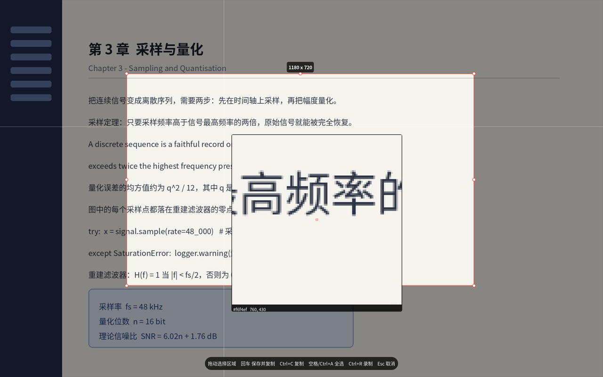
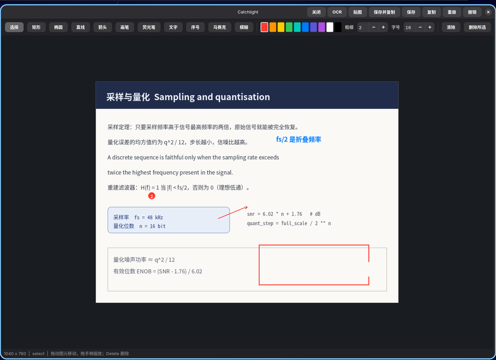
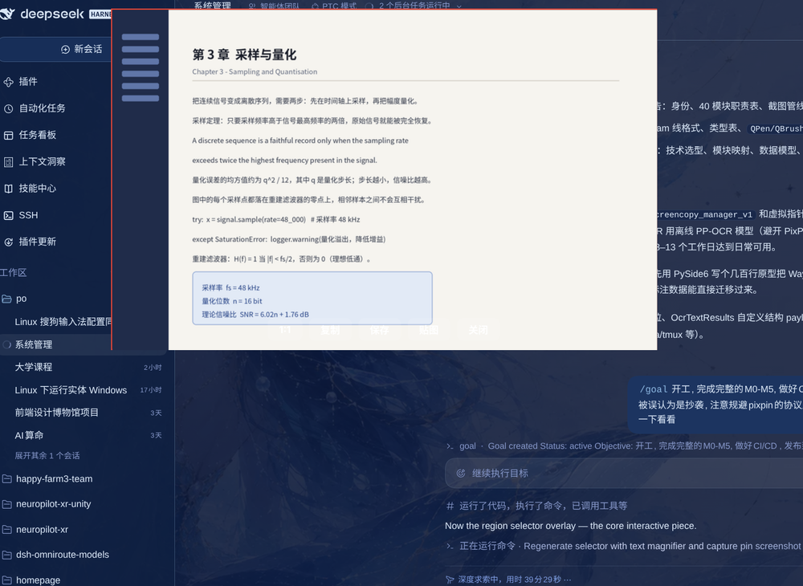
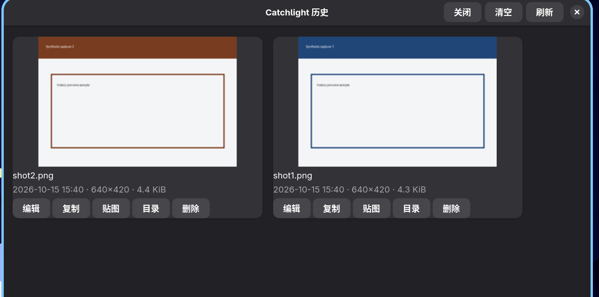
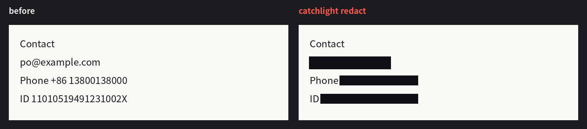
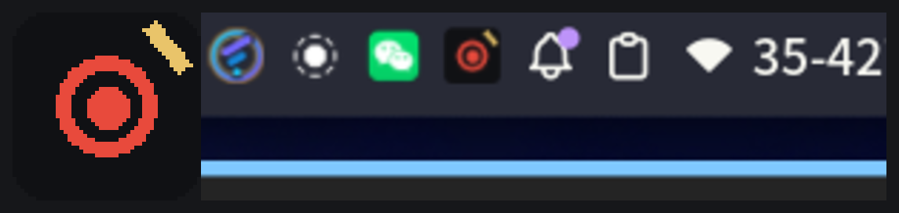

# Catchlight

[](https://github.com/publieople/catchlight/actions/workflows/ci.yml)
[](LICENSE)

A Wayland-native screenshot, annotation and pinboard tool, written in Python with GTK 4.

Catchlight shows a frozen frame of your desktop, lets you grab a region with pixel-accurate
control, annotate it, and then copy it, save it, OCR it, or pin it as a floating window. It
speaks wlr-screencopy through `grim` and wlr-layer-shell through `gtk4-layer-shell`, so it works
on wlroots-style compositors (niri, Hyprland, Sway, ...) without a portal.

> Independent implementation: no code, assets or file formats from any other screenshot tool are
> used. See [docs/INDEPENDENCE.md](docs/INDEPENDENCE.md).



*Region capture: a frozen frame of the desktop, the selected area at full brightness, eight resize
handles, a live size label, a magnifier with colour probe and the shortcut bar.*



*Editor: toolbar with eleven tools, colour palette, per-tool widths, snapshot undo/redo, and
save / copy / pin / OCR in the header bar.*



*Pinboard: any capture (or a file) can float above the desktop, draggable and zoomable, with a
hover toolbar to copy, save, pin again, centre, click through or fade.*



*The browsable capture history (`catchlight history --gui`).*



*`catchlight redact`: OCR finds emails, phone numbers, ID and bank card numbers and API keys,
then covers each hit with an opaque block (mosaic and blur are available too).*



*`catchlight tray`: a StatusNotifierItem icon in the bar; its menu captures a region or the whole
output, starts a recording, or opens the capture history.*

## Features

- **Region capture** on a frozen backdrop: per-output full-screen overlay, dimmed outside area,
  eight resize handles, live size label, magnifier with colour probe, crosshair.
- **Annotation editor**: rectangle, ellipse, line, arrow, pen, highlighter, text, serial numbers,
  mosaic and blur; ten-colour palette, per-tool widths, snapshot undo/redo, select and drag any
  item, save/copy/pin without leaving the window.
- **Pin**: drop one or more captures onto the screen as always-on-top floating windows; drag to
  move (with edge and centre snapping), scroll to zoom, per-pin opacity, click-through, a
  centre button and a hover toolbar with copy, save, pin-again and close. The link toggle
  (联动) ties two or more pins into a group that moves and zooms as one, and a group
  dissolves as soon as fewer than two pins are left in it.
- **OCR**: tesseract behind a wrapper that keeps word boxes and line grouping, with `eng+chi_sim`
  by default and 2x upscaling preprocess.
- **QR and barcodes**: `catchlight codes` decodes QR codes and 1D barcodes with `zbarimg`,
  either from a file or from a fresh region capture, as text or JSON.
- **Sensitive text**: `catchlight redact` runs OCR, finds emails, phone numbers, ID and bank
  card numbers and API keys, then paints opaque blocks over them (solid, mosaic or blur); the
  editor exposes the same pass as a toolbar button.
- **Scrolling capture**: `catchlight scroll` captures a region again after every page scroll,
  finds the rows the frames share and stitches them into one long image; scrolling is driven by
  wtype or ydotool, or by hand with `--manual`.
- **Recording**: region or whole output to MP4 (H.264) through `wf-recorder`, optional GIF
  conversion through ffmpeg, wall-clock limit, a small stop-recording window.
- **ScreenCast portal**: `--backend portal` drives `org.freedesktop.portal.ScreenCast`
  (CreateSession / SelectSources / Start / OpenPipeWireRemote) and grabs each shared monitor
  through GStreamer and PipeWire, so region and full captures work on compositors without
  wlr-screencopy too; compositors that only publish DMA-BUF streams are imported through GL.
- **Tray icon**: `catchlight tray` publishes a StatusNotifierItem icon whose dbusmenu captures a
  region or the whole output, starts a recording, opens the capture history, or quits; every row
  runs the matching CLI command in its own process.
- **Extras**: a browsable capture history window (`catchlight history --gui`), `.cln`
  editor projects, hotkey templates, `catchlight doctor`.

## Requirements

- Python 3.11 or newer, GTK 4, `gtk4-layer-shell`
- `grim` (capture) and a compositor that implements wlr-screencopy
- optional: `tesseract` + language data for OCR, `wf-recorder` and `ffmpeg` for recording,
  `wl-clipboard` when the GTK clipboard is not available
- optional: a StatusNotifierWatcher host (KDE Plasma, quickshell / noctalia, waybar, ...) for
  `catchlight tray`
- optional: for `--backend portal`, the desktop portal itself plus PyGObject, `pipewiresrc` and
  the GL plugins (Arch: `xdg-desktop-portal`, `python-gobject`, `gst-plugin-pipewire`,
  `gst-plugins-base`)

On Arch / CachyOS:

```fish
sudo pacman -S --needed python gtk4 gtk4-layer-shell grim tesseract tesseract-data-eng tesseract-data-chi_sim wf-recorder ffmpeg wl-clipboard
```

Runtime warning worth knowing: `gtk4-layer-shell` has to be preloaded before `libwayland`, so
Catchlight re-executes itself with `LD_PRELOAD` set when needed. Nothing is installed or changed
in your system; setting `CATCHLIGHT_NO_REEXEC=1` disables the re-exec.

## Install

```fish
git clone https://github.com/publieople/catchlight
cd catchlight
python3 -m venv .venv
source .venv/bin/activate.fish
pip install -e '.[gtk]'

# or, with pipx, keeping the GUI dependencies in one place:
pipx install 'catchlight[gtk] @ git+https://github.com/publieople/catchlight'
```

`PyGObject` and `pycairo` are the only Python dependencies of the GUI extra; the editor, the
renderer, the settings store and the CLI all work without them (that is what CI tests).

### Desktop integration

`packaging/` ships a desktop entry with region / full / record / OCR / history actions, AppStream
metadata and icons, so the tool shows up in application menus:

```fish
install -Dm644 packaging/io.github.catchlight.desktop ~/.local/share/applications/io.github.catchlight.desktop
install -Dm644 packaging/io.github.catchlight.metainfo.xml ~/.local/share/metainfo/io.github.catchlight.metainfo.xml
cp -r packaging/icons/hicolor ~/.local/share/icons/
```

A Flatpak manifest lives at `packaging/io.github.catchlight.yml`; it is a starting point and has
not been built in CI, because capture and overlay need a live Wayland session.

## Usage

```text
catchlight                     # region capture, straight into the editor
catchlight full                # whole output, into the editor
catchlight full --backend portal  # same, through the ScreenCast portal
catchlight capture --no-editor # capture and just save/copy
catchlight edit IMAGE          # open the editor on an existing file
catchlight pin IMAGE           # pin an image on the screen
catchlight ocr [IMAGE]         # recognise text (captures a region when no file is given)
catchlight codes [IMAGE]       # decode QR codes and barcodes
catchlight redact [IMAGE]      # find and cover sensitive text
catchlight scroll --steps 4    # scroll and stitch a long capture
catchlight tray                  # keep an icon in the system tray
catchlight record --duration 15 --gif
catchlight history --limit 10
catchlight history --gui       # browse the capture history
catchlight settings --show
catchlight settings --set capture.image_format=jpg
catchlight hotkeys --compositor niri
catchlight doctor              # check dependencies and environment
catchlight version
```

Useful flags: `--rect 100,100,800,600` to skip the overlay, `--backend auto|grim|portal`,
`--dir`, `--format`, `--no-copy`, `--delay SECONDS`, `--pin`, `--position X,Y`, `--scale`. Run
`catchlight COMMAND --help` for the full list.

## Shortcuts

Region overlay:

| Key | Action |
| --- | --- |
| drag | draw / move / resize the region |
| arrows, Shift+arrows | nudge by 1 px / 10 px |
| Ctrl + scroll | grow or shrink the region |
| Space / Ctrl+A | select the whole output |
| Backspace | clear the region |
| Enter | save and copy |
| Ctrl+C / Ctrl+S | copy only / save only |
| Ctrl+R | record the selected region |
| Esc / right click | cancel |

Editor:

| Key | Action |
| --- | --- |
| Ctrl+Z / Ctrl+Shift+Z | undo / redo |
| Ctrl+C / Ctrl+V | copy / paste an image |
| Ctrl+S / Ctrl+P | save / pin |
| Delete / Backspace | delete the selected item |
| Esc | deselect |
| + / - | change the tool width |
| 1 - 9 | pick a palette colour |

Pin window: `+` / `-` / `1` for zoom, Ctrl+C to copy, Ctrl+S to save, Esc or right click to
close. The hover toolbar adds `1:1` (reset zoom), copy, save, pin-again, centre, a
click-through toggle, an opacity slider and the link toggle (联动) that groups pins together.

## Compositor setup

`catchlight hotkeys` prints a ready-to-paste snippet for niri, Hyprland, Sway, GNOME, KDE or any
plain wlroots config. For niri:

```kdl
binds {
    Print { spawn-sh "catchlight region"; }
    Mod+Print { spawn-sh "catchlight full"; }
}
```

For Hyprland:

```text
bind = , Print, exec, catchlight region
bind = SUPER, Print, exec, catchlight full
```

## Configuration

Settings live in `~/.config/catchlight/config.json` and are written by `catchlight settings
--set SECTION.FIELD=VALUE`. The capturable sections are `capture`, `annotation`, `pin`, `ocr`
and `recording`; capture history is kept in `~/.local/share/catchlight/history.json` and
screenshots default to `~/Pictures/Screenshots`.

## Development

```fish
python3 -m venv .venv; source .venv/bin/activate.fish
pip install -e '.[dev]'
python -m pytest        # 73 tests, no display required
ruff check src tests
ruff format --check src tests
```

The test suite deliberately avoids GTK: everything under `catchlight/` except `catchlight.ui` is
importable headless, and the renderer is Pillow based, so CI runs on plain Ubuntu images. See
[docs/ARCHITECTURE.md](docs/ARCHITECTURE.md) for the module map and
[docs/ROADMAP.md](docs/ROADMAP.md) for milestone status.

## License

GPL-3.0-or-later. See [LICENSE](LICENSE).